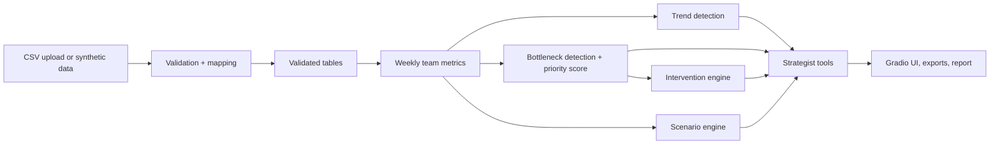

# TEMPO AI — Workforce Productivity & Operational Intelligence
Work smarter. Find the friction.

## Business problem
Working hours and overtime are rising while productivity stagnates or falls. TEMPO AI separates high effort from high output, finds operational bottlenecks (capacity, overtime, imbalance, approvals, dependencies, rework, absence cover, prioritisation, complexity mismatch), proposes evidence-linked interventions and simulates their effect. It aims at sustainable productivity, not longer hours. Bundled data is **fictional synthetic data** with planted patterns.

## Features
CSV upload with column mapping and row-level validation; productivity, workload, absence and backlog metrics with explicit denominators; trend detection; bottleneck radar with a configurable priority score; intervention playbook; scenario lab with constrained workload redistribution; deterministic strategist (optional LLM); exports and executive summary.

## Architecture


## Run
```
pip install -r requirements.txt
python app.py
```
Google Colab: paste `app.py` into one cell and run it. The `src/` modules from the brief are consolidated into `app.py`.

## Data, methodology, limits
See `docs/data_dictionary.md`, `docs/methodology.md`, `docs/bottleneck_scoring.md`, `docs/responsible_ai.md`, `docs/limitations.md`. If auto-detection fails, map columns in the app, for example `team_id=department, priority=prio`.

## Tests
```
pip install pytest
pytest tests
```

## LLM and privacy
Optional and off by default; set `ANTHROPIC_API_KEY` (see `.env.example`). Only aggregated results would be sent. Never commit real employee data or keys. Add screenshots to `screenshots/`.
